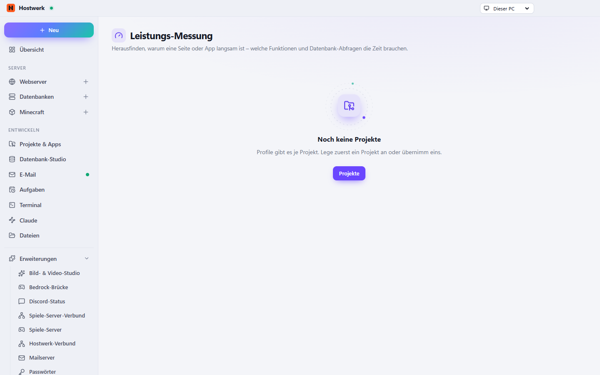

# Leistungs-Messung

Findet heraus, warum eine Seite oder App langsam ist: PHP-Profil mit einem Klick (Xdebug), Node- und Python-Apps über den Inspector bzw. cProfile.

[English](README.md) · Offizielle [Hostwerk](https://github.com/Passimoritz/hostwerk-public)-Erweiterung (native Erweiterung, ab Hostwerk 2.9)



## Was sie kann

- **Wo:** Reiter jedes Projekts – seit 1.1.1 ohne eigenen Seitenleisten-Eintrag; die ganze Seite bleibt unter Erweiterungen → Öffnen
- PHP-Profil per Klick (Xdebug wird nur für den Aufruf eingeschaltet und danach zurückgestellt – auch wenn etwas schiefgeht)
- Node.js-Apps über den Inspektor, Python über cProfile – eine Kopie läuft auf eigenem Port, die echte App bleibt unberührt
- Die langsamsten Funktionen, der Anteil der Datenbank und ein **Flammendiagramm** (Klick auf einen Balken vergrößert ihn)
- **Vorher und nachher**: die letzten 10 Messungen bleiben erhalten – zwei beliebige vergleichen, bis zur einzelnen Funktion
- **Anfrage messen**: jede Adresse mit GET, POST, PUT … und Inhalt; PHP-Projekte werden an ihrer Adresse erkannt. Der API-Tester nutzt dasselbe (`ctx.profiler.runRequest({ url, method, headers, body })`)
- **Kleiner Lasttest**: N Aufrufe, mehrere gleichzeitig, mit Median, 95 %, langsamstem Aufruf und Aufrufen pro Sekunde – nur gegen diesen Rechner oder dein eigenes Netz
- Verständliche Hinweise und eine KI-Erklärung, Reiter „Leistung“ in jedem Projekt, Fehlerzustände mit „Erneut versuchen“
- Steht unter „Entwickeln“ direkt hinter den Projekten; ein Tastenkürzel lässt sich unter Einstellungen → Allgemein → Tastenkürzel belegen

## Installieren

In Hostwerk unter **Erweiterungen → Entdecken** auf „Installieren“ klicken. Wer die Funktion schon in Hostwerk 2.8 benutzt hat, bekommt die Erweiterung beim Update automatisch – mit allen Daten.

Native Erweiterungen laufen als Teil von Hostwerk (eigener Server- und Oberflächen-Teil). Darum installiert Hostwerk sie nur aus dem offiziellen Katalog (mit Prüfsumme) oder im Entwickler-Modus.

## Daten

`data/profile` – genau dort, wo Hostwerk sie schon immer abgelegt hat. Entfernen der Erweiterung löscht nichts.

## Entwickeln

```bash
node --test tests/*.test.js          # Tests
node build-native.js .               # Oberfläche bauen (sdk/build-native.js aus hostwerk-public)
node check.js . --strict             # Prüfung wie im Katalog (sdk/check.js)
```

Quelltext der Oberfläche in `ui/src`, Server-Teil in `server/`. Texte im Code sind Englisch, Deutsch steht in `locales/de.json`.

## Lizenz

MIT
